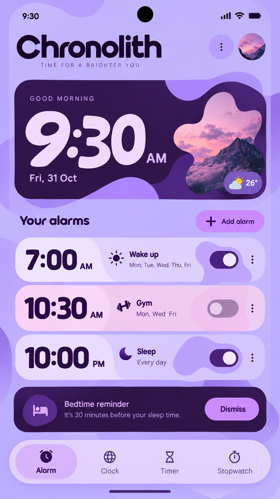

# Chronolith — Time for a Brighter You

[](.github/workflows/build-apk.yml)
[](https://flutter.dev)
[](https://m3.material.io/)
[](LICENSE)

**Chronolith** is an open-source Android clock suite crafted with **Flutter** and **Material 3 Expressive** design principles. Inspired by dreamy pastel lavender & deep plum aesthetics, organic scalloped shapes, fluid display typography, and Android 12+ Material You dynamic system colors, Chronolith brings five essential timekeeping tools into one cohesive experience.

---

## Visual Design & Mockup

<p align="center">
  
</p>

### Material 3 Expressive Highlights
- **Organic Scalloped & Wavy Geometry**: Custom `CustomClipper` and `CustomPainter` shapes render the 6-lobed scalloped mountain landscape cutout, layered hero waves, two-tone pastel time capsules, and 12-lobed M3 Expressive analog/timer dials.
- **Dreamy Lavender, Dynamic Material You & Nocturne Themes**: Ships with the exact **Dreamy Lavender & Deep Plum** palette from the design mockup while supporting one-tap switching to **Android 12+ Material You Dynamic System Colors** (`dynamic_color`) or **Deep Plum Nocturne** dark mode.
- **Expressive Typography**: Combines playful, high-impact rounded numerals (`Fredoka`) with crisp geometric UI labels (`Plus Jakarta Sans`).

---

## Five-Tab Clock Suite

| Tab | Key Features |
| :--- | :--- |
| **1. Alarm** | Hero time & weather card (`26°` badge + scalloped alpine sunset cutout), `+ Add alarm` pill button, two-tone pastel alarm cards (`Wake up`, `Gym`, `Sleep`) with oversized Material 3 Expressive pill switches, interactive Add/Edit modal bottom sheet, and a dismissible **Bedtime reminder** banner. |
| **2. Clock** | Live digital & 12-lobed scalloped analog chronograph, timezone indicator, **Daylight & Sleep Cycle** circadian progress bar, gentle hourly chime toggle, and a full-screen **Bedside Ambient Nightstand Mode**. |
| **3. World** | Interactive **Global Time Compass** slider (`-12h` to `+12h`) to preview meeting hours across timezones, day/night sun & moon indicators, relative offset labels, and a searchable city directory (`+ Add city`). |
| **4. Timer** | Scalloped circular countdown ring in a deep plum hero container, `+1:00` quick-boost pill button, `Start`/`Pause`/`Reset` controls, and organic preset cards (`5m Herbal Steep`, `15m Power Nap`, `25m Deep Focus`, `45m Gym Circuit`). |
| **5. Stopwatch** | High-precision centisecond stopwatch (`MM:SS.cc`), one-tap lap recording, split & cumulative lap comparison, and automatic **FASTEST** / **SLOWEST** lap badges. |

---

## Project Structure

```text
chronolith/
├── .github/
│   └── workflows/
│       └── build-apk.yml          # Automated CI/CD: lint, test & build APK on every push
├── android/                       # Android Gradle & Manifest configuration (JDK 17, minSdk 24)
├── assets/
│   └── images/
│       ├── mountain_sunset.png    # Alpine sunset artwork for the scalloped hero cutout
│       └── avatar_sunset.png      # Header profile badge artwork
├── docs/
│   └── images/
│       └── chronolith_mockup.png  # UI design mockup reference
├── lib/
│   ├── main.dart                  # App entry point, DynamicColorBuilder & 5-tab scaffold
│   ├── models/
│   │   └── clock_models.dart      # Data models for Alarms, World Cities, Presets & Laps
│   ├── screens/
│   │   ├── alarm_tab.dart         # Tab 1: Dreamy Alarm Dashboard & Bedtime Reminder
│   │   ├── clock_tab.dart         # Tab 2: Scalloped Analog/Digital Clock & Bedside Mode
│   │   ├── world_clock_tab.dart   # Tab 3: Multi-Timezone Cards & Time Scrubber
│   │   ├── timer_tab.dart         # Tab 4: Expressive Countdown Ring & Presets
│   │   └── stopwatch_tab.dart     # Tab 5: Precision Stopwatch & Lap Splits
│   ├── theme/
│   │   └── chronolith_theme.dart  # Mockup palette, Nocturne dark theme & M3 dynamic color harmonizer
│   └── widgets/
│       ├── bottom_nav_pill.dart   # Floating 5-tab rounded pill navigation bar
│       ├── hero_clock_card.dart   # Deep plum hero card with scalloped mountain cutout & weather pill
│       └── organic_shapes.dart    # Custom clippers, wavy painters & expressive pill switch
├── test/
│   └── widget_test.dart           # Automated widget test suite across all 5 tabs
├── analysis_options.yaml
├── LICENSE                        # MIT License
└── pubspec.yaml
```

---

## Getting Started

### Prerequisites
- [Flutter SDK](https://docs.flutter.dev/get-started/install) `>=3.2.0`
- Java 17 (JDK 17) & Android SDK (API 24+)

### Run Locally

```bash
# 1. Clone the repository
git clone https://github.com/<your-username>/chronolith.git
cd chronolith

# 2. Fetch Flutter packages
flutter pub get

# 3. Ensure platform wrapper files are generated
flutter create . --project-name chronolith --org dev.chronolith.app --platforms android

# 4. Run on a connected Android device or emulator
flutter run

# 5. Build a standalone Release APK
flutter build apk --release
```

The compiled APK will be generated at:
`build/app/outputs/flutter-apk/app-release.apk`

---

## Automated GitHub Actions APK Builds

Every push and pull request to `main`, `master`, or `develop` triggers [`.github/workflows/build-apk.yml`](.github/workflows/build-apk.yml), which:
1. Sets up **Temurin JDK 17** and the latest stable **Flutter SDK** with dependency caching.
2. Runs `flutter analyze` and `flutter test` to verify code quality and widget behavior.
3. Compiles both `app-debug.apk` and `app-release.apk`.
4. Uploads both APKs directly to the workflow run's **Artifacts** tab for instant download.
5. Automatically attaches the APKs to a **GitHub Release** whenever you push a version tag (e.g., `git tag v1.0.0 && git push origin v1.0.0`).

---

## License

Distributed under the **MIT License**. See [`LICENSE`](LICENSE) for full details.
